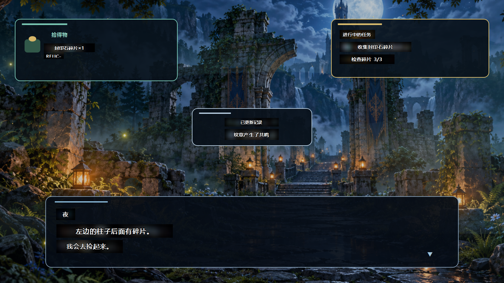
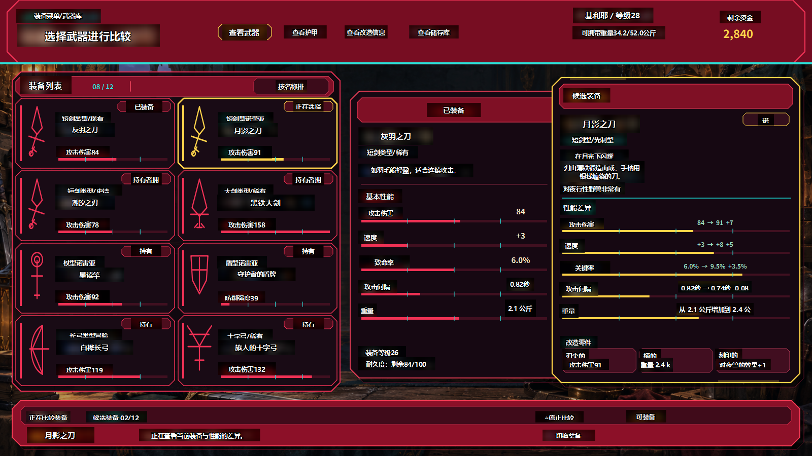
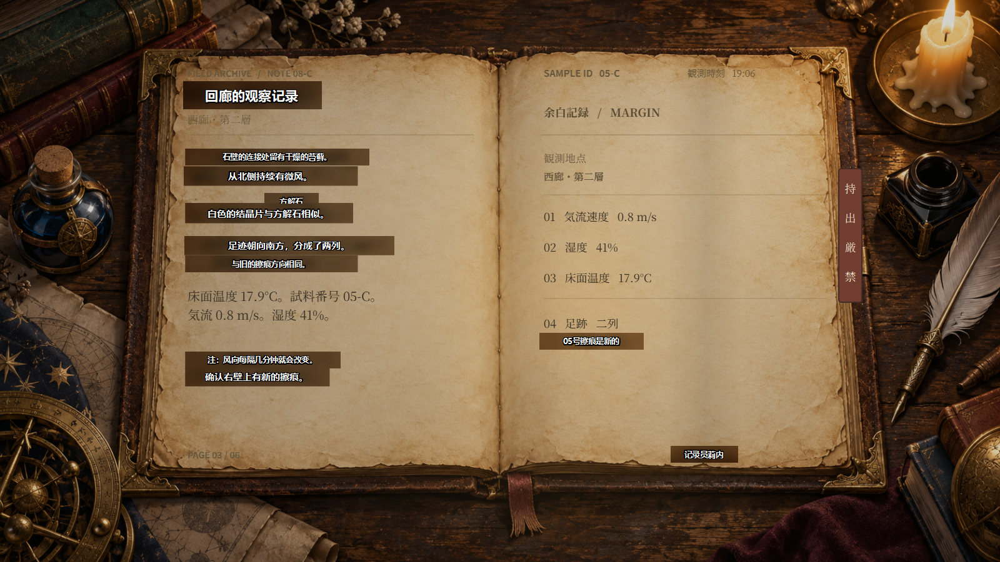
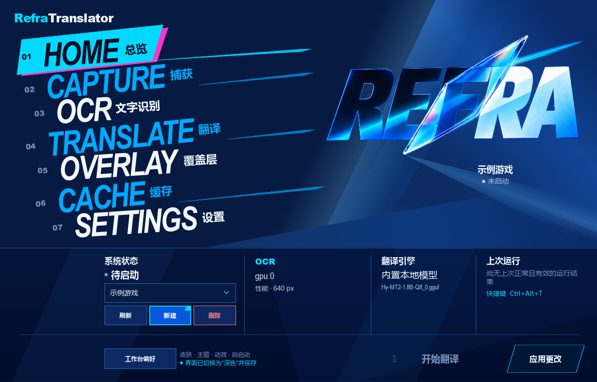
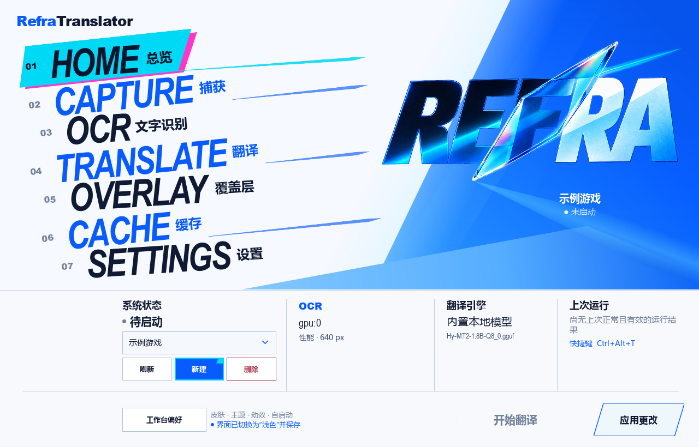
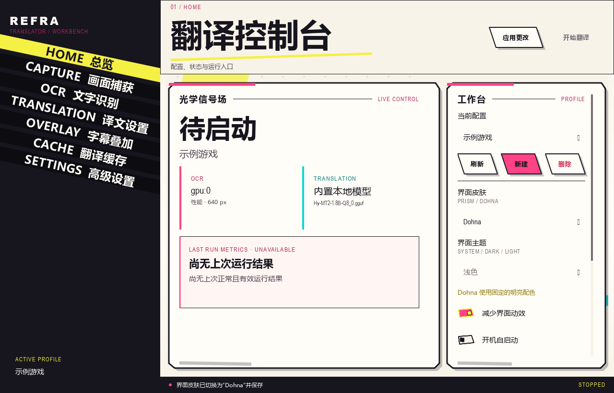
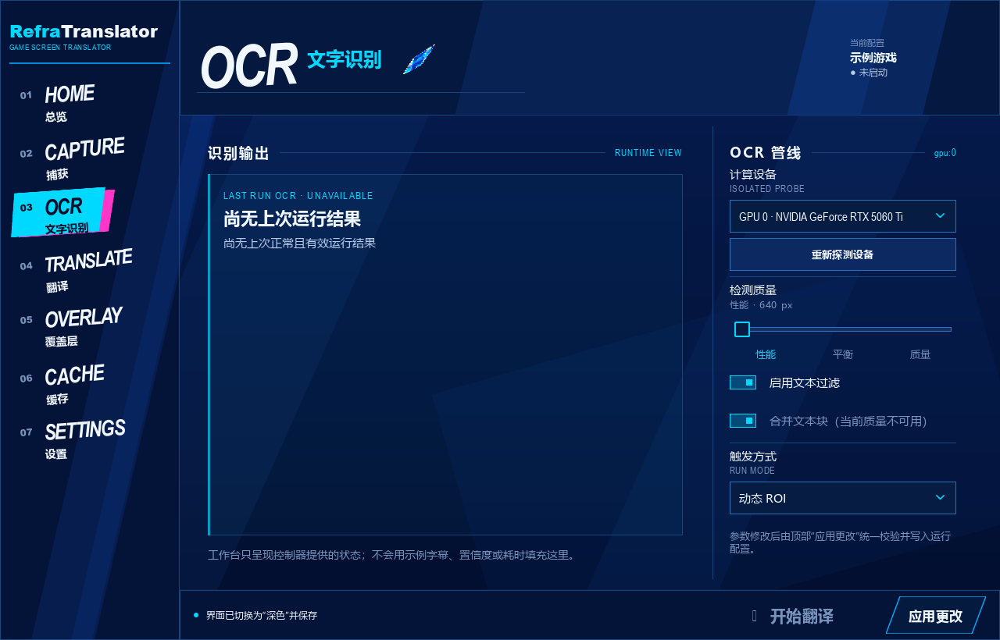
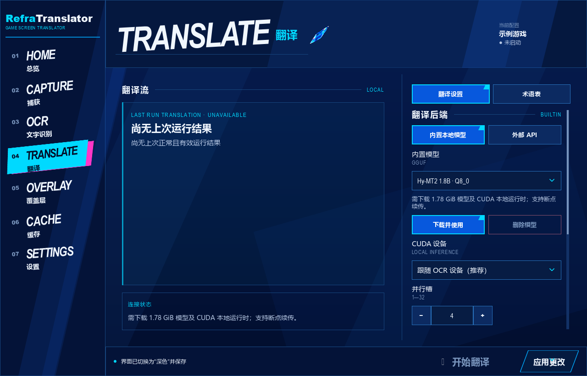
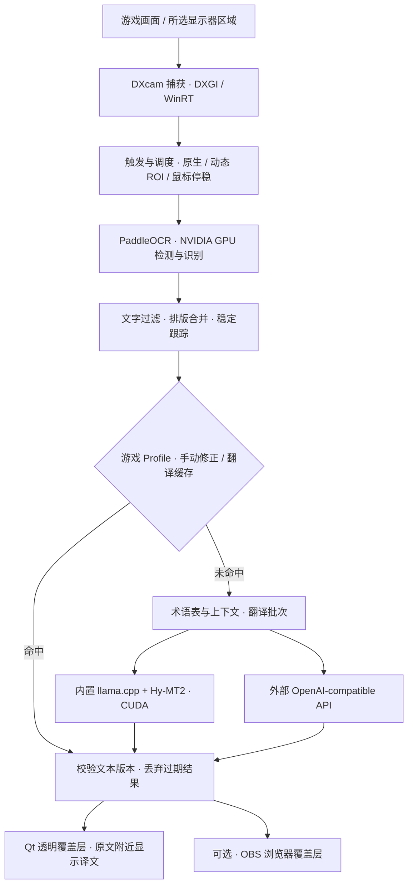

# RefraTranslator

RefraTranslator 是一款 Windows 游戏屏幕翻译工具：它自动识别画面中的日文或英文，并把中文译文显示在原文字附近。

程序不会修改或注入游戏。目前仍是 Alpha 版本，建议先在普通窗口或无边框窗口中试用。

> [!IMPORTANT]
> 当前版本只支持 Windows 10/11 和 NVIDIA 显卡。没有可用的 NVIDIA 显卡时，实时翻译无法启动。

[**下载 Windows 安装包**](https://github.com/hasyur/RefraTranslator/releases)

[产品界面](#产品界面) · [核心功能](#核心功能) · [技术方案](#技术方案) · [安装与启动](#安装与启动) · [常见问题](#常见问题)

## 产品界面

### 翻译效果

以下为自有游戏风格测试场景上的实际运行截图，使用 **PaddleOCR GPU + Hy-MT2 1.8B** 识别与翻译，中文由程序直接覆盖在画面上。

**对白与任务提示**：在同一画面中翻译底部对白、右上任务和拾取提示。



**装备菜单**：翻译装备名称、属性说明和菜单按钮。



**长段落文本**：在记录页面的原文位置显示中文，保留页面布局与背景。



### 工作台

**Prism 深色工作台**：从游戏配置出发，在捕获、识别、翻译、覆盖层与缓存之间切换。



<details>
<summary>查看 Prism 浅色主题与 Dohna 皮肤</summary>

**Prism 浅色**沿用相同的导航与操作位置，采用冷白与电蓝分区。



**Dohna**提供另一套明亮配色、布局和动效，共用同一套业务功能。



</details>

<details>
<summary>查看 OCR 触发方式与本地翻译模型设置</summary>

**OCR / 文字识别**：选择识别设备、检测质量和触发方式。



**TRANSLATION / 翻译**：管理内置模型，也可切换到外部 API；术语表位于同页。



</details>

工作台截图使用独立的“示例游戏”配置，展示启动前的设置状态。

## 核心功能

| 功能 | 可以做什么 |
| --- | --- |
| 屏幕翻译覆盖层 | 识别画面中的日文、英文，在原文附近显示中文；支持原文模糊和遮罩透明度调整，覆盖层可穿透鼠标操作。 |
| 自定义捕获区域 | 选择显示器并框选字幕、菜单等区域；区域按比例保存，切换分辨率后换算。 |
| 三种 OCR 触发方式 | 原生整区识别、默认的动态 ROI 局部识别，以及鼠标移动并停稳后的一次性按需识别。 |
| 内置本地翻译 | 管理 Hy-MT2 模型及 CUDA 运行资源；完成资源准备后，OCR 和内置模型推理均在本机完成。 |
| 外部翻译服务 | 可选接入 OpenAI-compatible API，自行配置服务地址、密钥和模型。 |
| 每游戏独立配置 | 捕获、识别、翻译、覆盖层和运行参数随游戏切换；术语表、翻译缓存和手动修正也按游戏保存。 |
| 结果回看与修订 | 查看上次运行的识别、翻译和缓存结果，维护术语表与人工修正，复用已有译文。 |
| 工作台与录制支持 | Prism 深浅主题、Dohna 皮肤、减少动效、托盘和全局快捷键；可选开启透明的 OBS 浏览器覆盖层。 |

## 技术方案

应用采用 **Python + PySide6 / Qt Quick** 构建 Windows 工作台，以屏幕捕获作为输入，通过 GPU OCR 和翻译服务生成独立覆盖层，不需要读取游戏文本接口。



## 安装与启动

**普通用户推荐使用 EXE 安装版。** 安装包自带 Python 和图形界面运行环境，不需要先安装 Python、Git，也不需要手动运行 pip 或 PowerShell。

1. 打开 [发布下载页面](https://github.com/hasyur/RefraTranslator/releases)，在最新版本的 **Assets / 附件** 中下载 `RefraTranslator-Setup.exe`，安装包约 **176 MiB**；
2. 双击安装包，按向导选择本地可写的安装目录；需要桌面入口时勾选 **创建桌面快捷方式**；
3. 安装完成后，从开始菜单打开 RefraTranslator，也可以使用已创建的桌面快捷方式，或双击安装目录中的 `RefraTranslator.exe`。

### 安装前确认

电脑需要满足以下条件：

- 64 位 Windows 10 或 Windows 11；
- 支持 CUDA 的 NVIDIA 显卡，并已安装可用的 NVIDIA 驱动；
- 首次安装和下载模型时可以访问网络，并留出下载缓存和解包所需磁盘空间；程序会在资源准备前检查空间是否充足。

### 第一次启动和配置

安装包包含应用和界面运行环境。首次使用屏幕识别还需下载约 **3 GiB** 的 NVIDIA OCR 运行依赖和检测、识别模型；已有资源和续传缓存会扣除，以准备窗口显示的实际大小为准。准备窗口分别显示**总下载进度**和**当前文件进度**；下载完成后还会安装、解压并校验资源。

首次完整 OCR 准备目前约需 **13 GiB 可用磁盘空间**，用于下载、临时解包和安装；已有资源会降低需求，翻译模型另需空间，以程序检查结果为准。

1. 首次打开会显示 OCR GPU 运行依赖、文字检测模型和文字识别模型的状态与大小；确认后点击 **下载并准备**。已存在并通过校验的资源会复用，失败后可以重试，也可以选择 **稍后准备** 先进入工作台；资源就绪后才能开始屏幕识别；
2. 在 **HOME / 总览** 中点击 **新建**，输入游戏名称。Prism 深浅主题的首页使用大幅错落菜单导航，其他页面使用左侧七页导航；Dohna 使用原有左侧导航；
3. 在 **CAPTURE / 捕获** 中选择游戏所在的显示器；
4. 选择 **自定义区域**，框住经常出现字幕的位置；区域按显示器比例保存，切换分辨率后自动换算。界面像素值对应当前显示器；旧像素区域默认重置为全屏，重新框选并保存即可；
5. 进入 **OCR / 文字识别**，等待页面显示检测到的 NVIDIA 显卡，只有一张显卡时保持默认即可；
6. 进入 **TRANSLATION / 翻译**，首次安装默认使用 **内置本地模型（CUDA）**；
7. 默认模型为 **Hy-MT2 1.8B · Q8_0**，点击 **下载并使用**，等待下载和校验完成；
8. 打开游戏并让字幕出现在刚才框选的区域，然后点击全局 **开始翻译**。Prism 深浅主题在工作台底部提供全局 **开始翻译** 和 **应用更改**；Dohna 使用原有顶部操作区。

首次准备只包含 NVIDIA OCR 运行依赖和 OCR 检测、识别模型，不会下载 llama.cpp、CUDA LLM 运行库或翻译模型。内置翻译仍由 **TRANSLATION / 翻译 → 下载并使用** 单独准备。

看到中文覆盖在原文字附近，就说明已经运行成功。工作台在实时翻译就绪后会隐藏，屏幕顶部会出现居中的只读状态条；需要调整或结束时，双击系统托盘中的 RefraTranslator 图标唤回工作台。工作台运行中点击右上角 **×** 会重新隐藏到托盘，翻译继续；点击工作台的 **停止翻译** 才会执行保存并停止流程。

### 日常启动

在 **OCR / 文字识别 → 触发方式** 中选择一种运行方式：

- **原生**：按原有画面变化与复查策略识别整个所选区域。
- **动态 ROI**（默认）：持续检测变化，优先局部识别，必要时回退整区扫描。
- **鼠标触发**：按需省资源模式。鼠标距离上次成功触发位置移动约 30 像素并停稳后，处理一次所选区域；共用 ROI 与翻译核心，完成后停止采集并等待下次触发。首次停稳也会触发。

选择鼠标触发后可调整 **鼠标停稳等待**，默认 300 毫秒。此模式保留上次译文，可能错过两次触发之间短暂出现的文字；减少 GPU 运行时间不代表总是更快，也不保证释放已加载模型的显存。方式和等待时间随游戏配置保存，停止翻译后可修改。

从开始菜单、桌面快捷方式或安装目录中的 `RefraTranslator.exe` 打开程序。程序会自动选择上次使用的游戏配置，再点击 **开始翻译**。上次的配置不存在时会选择列表中的第一个配置；启动页面仍为 HOME。每个配置会独立保存捕获区域、OCR、翻译、覆盖层和运行参数；切换游戏配置时会整套切换，不会沿用另一个游戏的设置。主题、窗口状态、已下载模型文件和设备检测结果仍由本机共享。

在 **HOME / 总览 → 当前配置** 中选中已有配置后，点击 **删除** 并确认即可移除它。删除会一并移除该配置的设置、术语表、翻译缓存、手动修正和运行快照，无法撤销；翻译运行期间需先停止翻译。删除后会选择剩余配置，没有配置时可以点击 **新建**。

若文件占用导致清理未完成，配置仍会从列表移除，界面会提示残留目录；解除文件占用后可删除提示中的目录。

程序已在运行时，再次打开会唤回已有工作台；如果正在翻译，会先保存并停止当前翻译，再打开工作台。

Prism 深浅主题在 **HOME / 总览 → 工作台偏好** 中调整皮肤、主题、减少动效、自启动和快捷键；Dohna 保留 **HOME / 总览 → 界面皮肤** 的原有设置路径。两种 Prism 主题共用错落斜体首页菜单、折射主视觉、青粉选中装饰和相同的操作位置，其他页面使用左侧导航；深色以深海蓝为底，浅色首页采用冷白与电蓝分区，表单使用浅底深色文字。Dohna 使用固定的明亮配色，页面切换采用不透明内容组横向推入，按压和错误反馈采用短促的斜切色块。皮肤和主题选择保存在配置旁的本机 `.gui-settings.toml`，下次启动自动恢复。勾选“减少界面动效”或隐藏窗口时，动效会立即收束。

## 更新

### EXE 安装版

1. 关闭 RefraTranslator，包括仍在托盘中运行的程序；
2. 从 [发布下载页面](https://github.com/hasyur/RefraTranslator/releases) 下载新版 `RefraTranslator-Setup.exe`；
3. 运行安装包，**选择原安装目录**，完成后重新打开程序。

直接覆盖安装即可更新，无需先卸载。安装器会更新程序文件，保留安装目录中的配置、游戏档案、日志、模型和已准备的运行资源。更新前可备份该目录中的个人数据；更换安装目录时，需要手动复制要沿用的数据，见下方“数据位置与迁移”。

### 下载中断或需要修复

- 首次资源下载中断：重新打开安装版，资源清单会复用已完成和可续传的文件；可以点击 **重试**，也可以先选 **稍后准备**，不影响打开工作台；
- 安装目录需要修复：关闭 RefraTranslator 后再次运行 `RefraTranslator-Setup.exe`，选择原安装目录。配置、游戏 Profile 和模型资源保存在安装目录，安装器更新程序文件时会保留这些数据；
- 安装版启动失败：检查安装目录下的 `output\launcher.log`；
- 实时翻译失败：检查安装目录下的 `output\live.log`。

## 常见问题

| 现象 | 先这样检查 |
| --- | --- |
| 没有检测到显卡 | 确认电脑使用 NVIDIA 显卡并已安装驱动；可以在命令提示符中运行 `nvidia-smi` 检查驱动；当前版本不能改用 CPU OCR |
| 双击安装版后工作台没有打开 | 查看安装目录下的 `output\launcher.log` |
| 点击开始后退出，或一直没有译文 | 查看 `output\live.log`，并确认框选区域内确实有日文或英文 |
| 内置模型显存不足 | 先使用 1.8B 模型，并把高级设置中的并发槽位保持为 1 |
| 看不到控制框或译文 | 先用本机有线显示器和窗口化游戏测试；部分无线投屏、虚拟显示器或捕获链路不兼容 |

模型下载中断后，可以再次点击 **下载并使用**；模型下载支持断点续传。

## 使用外部 API（可选）

如果你已经有 OpenAI-compatible 翻译服务：

1. 在 **翻译** 中选择 **外部 API**；
2. 填写 API 地址和 API Key；
3. 读取并选择模型，然后点击 **开始翻译**。

服务需要提供 `/v1/models` 和 `/v1/chat/completions`。API Key 会明文保存在当前 Profile 的本机 `settings.toml` 中；如果不想保存，可以留空并使用 `REFRA_TRANSLATOR_API_KEY` 环境变量。

## 数据位置与迁移

程序文件、配置、游戏档案、日志、模型和运行资源统一保存在你选择的安装目录中：

```text
安装目录/
  RefraTranslator.exe
  runtime/               内置 Python 和 OCR 运行依赖
  config.toml            程序配置
  .gui-settings.toml     界面偏好
  profiles/              游戏档案、翻译缓存和快照
  output/                启动和运行日志
  .cache/                模型、运行资源及界面编译与渲染缓存
```

下载和解包中间文件也放在安装目录的 `.cache` 下。安装完成并通过资源校验后会自动清理已用完的下载包；中断或失败时保留已完成文件和 `.part` 续传文件。模型和可用运行时会长期保留。

### 从旧版用户目录手动迁移

`v0.1.0-alpha.1` 和 `v0.1.0-alpha.2` 默认把用户数据保存在 `%LOCALAPPDATA%\RefraTranslator`。新版只使用安装目录中的数据，旧目录会保持原样，不自动搬移或清理。

需要沿用旧数据时，先退出程序，再将旧目录中的 `config.toml`、`.gui-settings.toml`、`profiles`、`.cache` 和 `output` 搬到实际安装目录，然后启动新版。复制前保留已有数据的备份，遇到同名文件时由你选择保留的版本。默认配置使用相对路径，模型和续传文件可直接复用；自定义字体等外部文件也需要一并搬移。若旧配置使用绝对路径，需将它更新为安装目录内的对应路径。

## 源码安装与开发（可选）

需要修改代码或运行测试时，可以使用源码开发环境。源码仓库保留 `install.bat` 和 `bootstrap.ps1`：

1. 获取项目文件：
   - 不使用 Git：在 GitHub 页面点击 **Code → Download ZIP**，下载后完整解压；
   - 使用 Git：运行 `git clone https://github.com/hasyur/RefraTranslator.git C:\RefraTranslator`。
2. 将项目放在较短、可写的本地路径，例如 `C:\RefraTranslator`。不要直接在 ZIP 压缩包内运行，也不建议放在层级很深的目录中；
3. 安装 64 位 Python 3.11、3.12 或 3.13，并确保 `python.exe` 可从 PATH 调用；
4. 双击项目根目录中的 `install.bat`；
5. 保持窗口打开，直到看到 `Installation completed successfully`；
6. 双击 `start_gui.bat` 启动 RefraTranslator。

安装程序会自动：

- 检查 Python 版本；
- 在项目目录创建独立的 `.venv` 虚拟环境；
- 安装图形界面、NVIDIA GPU OCR 和项目依赖；
- 更新时先检查已有 Paddle GPU 和 CUDA 能否正常运算；可用且版本兼容时直接复用，跳过 GPU 大包下载，否则重新安装；
- 首次安装时从 `config.example.toml` 创建本机 `config.toml`，再次安装时保留已有配置；
- 安装成功后清理 `.cache\pip` 中的安装下载缓存。

开发安装会把依赖放在项目目录的 `.venv` 中，不会安装到系统 Python。

### 测试与安装参数

需要同时安装测试依赖时，在项目根目录打开 PowerShell，运行：

```powershell
powershell.exe -NoProfile -ExecutionPolicy Bypass -File .\bootstrap.ps1 -WithGui -WithDev
.\.venv\Scripts\python.exe -m pytest -m "not integration"
```

`bootstrap.ps1` 还支持 `-KeepInstallCache` 保留安装下载缓存。默认安装会保留兼容的现有 CUDA 版本；显式指定 `-GpuCuda` 时，安装程序会检查版本是否匹配，必要时安装指定版本。

### GUI 皮肤维护

`src/game_screen_translator/gui/qml/Main.qml` 是中性工作台宿主，整个窗口只创建一个业务控制器；`qml/skins/prism/` 和 `qml/skins/dohna/` 各自维护皮肤的工作台布局、页面、控件、主题、动效和资源。只改其中一套皮肤时，在对应目录内调整，不从另一套皮肤导入视觉组件。新增图片等资源也放在对应皮肤的 `assets/` 中；`pyproject.toml` 与 `MANIFEST.in` 负责把 QML 和资源纳入安装包。

换肤时由宿主保留业务控制器，并通过 `qml/shared/ScrollPositionSync.qml` 同步跨皮肤需要延续的临时界面状态；页面和操作仍调用同一控制器。相关隔离、换肤状态和 QML 行为检查位于 `tests/test_qml_workbench.py`，发布包内容检查位于 `tests/test_release.py`。运行完整非集成测试可使用上面的 pytest 命令；需要验证 Dohna 菜单斜切命中区域时，须在 Windows 原生窗口平台运行对应 GUI 测试，软件渲染的像素尺寸不作替代。

### 源码更新

通过 Git 获取项目后，关闭 RefraTranslator，在克隆的项目目录打开 PowerShell 并执行：

```powershell
git pull
```

如果更新修改了 `pyproject.toml` 中的依赖，再双击 `install.bat` 安装依赖。

通过源码 ZIP 安装的用户更新时，可先退出程序并备份旧目录，再将新版 ZIP 解压后的文件覆盖到原开发目录，保留 `.venv`、`.cache`、`config.toml`、`.gui-settings.toml`、`profiles` 和 `output`，然后再次双击 `install.bat`。已有可用的 Paddle GPU 和 CUDA 环境会复用；翻译模型和 OCR 模型缓存也会保留。

### 开发安装排查

- 使用 `start_gui(debug).bat` 保持 CMD 可见、查看即时启动输出；它与 `start_gui.bat` 调用同一个启动后端。日志位于项目目录下的 `output\launcher.log` 和 `output\live.log`；
- 虚拟环境损坏时关闭 RefraTranslator，只删除项目根目录中的 `.venv`，再运行 `install.bat`；
- 无法读取 `WindowsApps\python.exe` 的版本时，这通常是 Microsoft Store 执行别名。安装 64 位 Python 3.11～3.13 并勾选 **Add python.exe to PATH**；若已安装，在 Windows“应用执行别名”中关闭 `python.exe` 和 `python3.exe` 的商店别名，再运行 `where.exe python` 与 `python --version` 确认。

## 当前限制

- 内置模型只支持 Windows x64 + NVIDIA CUDA，不会回退到 CPU 或 Vulkan；
- 项目仍处于 Alpha 阶段，请先在非关键环境中试用。

## 许可证

RefraTranslator 源代码采用 [Apache License 2.0](LICENSE)。按需下载的 llama.cpp、NVIDIA CUDA 运行库、Hy-MT2 模型及其他第三方依赖使用各自的许可证，详见 [THIRD_PARTY_NOTICES.md](THIRD_PARTY_NOTICES.md)。
